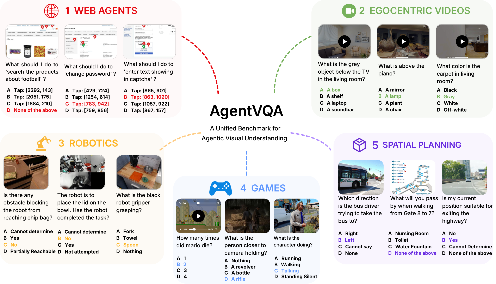
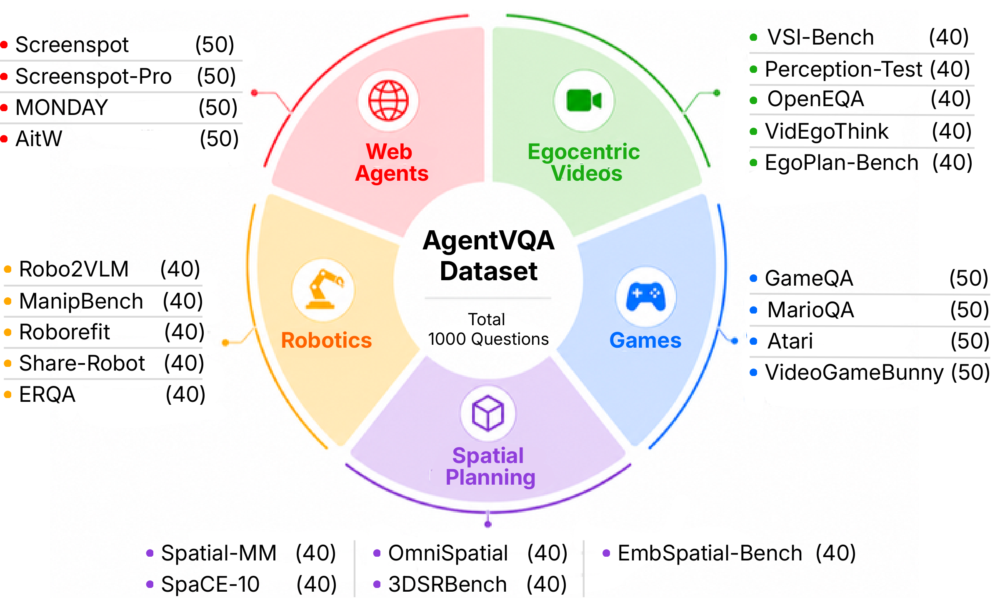
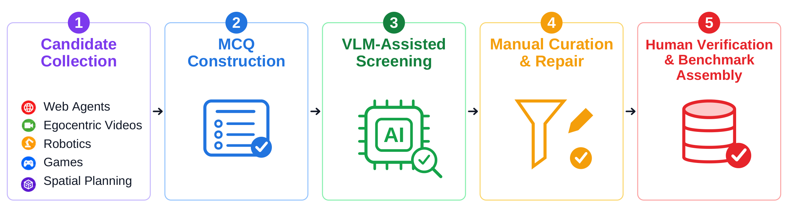

<p align="center">
  <a href="https://openreview.net/pdf?id=MQinK5xoYM">
    
  </a>
  <a href="https://huggingface.co/datasets/zlab-princeton/AgentVQA">
    
  </a>
  <a href="https://zlab-princeton.github.io/AgentVQA/">
    
  </a>
</p>

# AgentVQA: A Unified Benchmark for Agentic Visual Understanding

Advait Gupta, Sachin Konan, Tom Yin, Gabriel Sarch<sup>* </sup>, Zhuang Liu<sup>*</sup>

<sup>*</sup> Equal advising.

AgentVQA is an offline benchmark for evaluating visual understanding in realistic agentic scenarios. It tests the perceptual, spatial, temporal, and reasoning capabilities needed for goal-directed interaction, providing a common evaluation across GUI navigation, embodied tasks, gameplay, and spatial planning.

<p align="center">
  <a href="assets/overview.png"></a>
</p>

## Overview

AgentVQA contains **1,000 manually verified multiple-choice questions** from **23 datasets** across **five domains**, with **200 questions per domain**. Inputs include single images, multiple images, and videos, with episode goals and action histories where available. Tasks express coordinates, actions, spatial relations, and predicted states through a shared multiple-choice format while preserving the original agentic context.

<p align="center">
  <a href="assets/distribution.png"></a>
</p>

The dataset and media are available on [Hugging Face](https://huggingface.co/datasets/AgentVQA/AgentVQA).

## Dataset Curation

The five-stage pipeline combines model assistance with human judgment: candidate collection, multiple-choice construction with challenging distractors, VLM-assisted screening, manual curation and repair, and final human verification. Annotators review and revise questions, answers, visual inputs, and distractors to ensure one correct answer and plausible but unambiguously incorrect alternatives. About 22% of the initial candidates survive the full pipeline.

<p align="center">
  <a href="assets/curation.png"></a>
</p>

## Results

Across 22 model configurations evaluated in the paper, the strongest model reaches **58.5% accuracy**, and no single model leads every domain. The table below reproduces the paper's reported accuracies (%); bold indicates the best score in each column. See the [paper](https://openreview.net/pdf?id=MQinK5xoYM) for the evaluation protocol and further analysis.

| Model | Web Agents | Egocentric Videos | Games | Spatial Planning | Robotics | Overall |
| --- | ---: | ---: | ---: | ---: | ---: | ---: |
| GPT-5.6-sol (thinking-high) | **47.0** | 69.0 | 62.5 | 51.0 | 45.5 | 55.0 |
| GPT-5.6-sol (thinking-none) | 16.0 | 59.0 | 44.5 | 41.0 | 30.5 | 38.2 |
| GPT-5.6-luna (thinking-high) | 34.5 | 65.0 | 61.0 | 43.5 | 35.5 | 47.9 |
| GPT-5.6-luna (thinking-none) | 19.5 | 46.0 | 37.5 | 32.0 | 29.0 | 32.8 |
| GPT-4o | 21.5 | 40.0 | 29.0 | 35.0 | 31.5 | 31.4 |
| Gemini 3.1 Pro | 34.5 | 64.0 | 68.0 | 61.0 | 51.0 | 55.7 |
| Gemini 3.7 Flash | 40.5 | 67.0 | **70.0** | **62.5** | **52.5** | **58.5** |
| Claude Opus 4.8 | 35.5 | 60.0 | 50.5 | 41.0 | 33.0 | 44.0 |
| Claude Sonnet 5 | 38.0 | 47.0 | 53.0 | 42.5 | 36.5 | 43.4 |
| GLM-4.6V | 25.5 | 54.0 | 47.5 | 39.5 | 42.5 | 41.8 |
| GLM-4.5V | 25.0 | 65.0 | 46.5 | 41.0 | 37.0 | 42.9 |
| GLM-4.1V-9B-Thinking | 19.0 | 53.0 | 41.0 | 38.5 | 25.5 | 35.4 |
| GLM-4.1V-9B-Base | 20.5 | 46.0 | 37.5 | 44.5 | 33.0 | 36.3 |
| Kimi K3 | 22.0 | 64.0 | 63.5 | 53.0 | 39.0 | 48.3 |
| Llama 4 Maverick | 18.5 | 49.0 | 23.0 | 30.0 | 19.5 | 28.0 |
| Qwen3.8 27B | 30.0 | 69.0 | 61.5 | 51.5 | 42.5 | 50.9 |
| Qwen3.7 Plus | 32.5 | 60.0 | 61.5 | 50.0 | 39.0 | 48.6 |
| Qwen3.7 Flash | 43.0 | **72.5** | 61.0 | 55.0 | 43.5 | 55.0 |
| Qwen3.5 397B-A17B | 25.0 | 65.0 | 57.5 | 51.5 | 40.0 | 47.8 |
| Qwen3.5 122B-A10B | 26.0 | 60.0 | 53.0 | 50.0 | 41.0 | 46.0 |
| Qwen3.5 35B-A3B | 34.5 | 62.0 | 55.5 | 45.5 | 42.0 | 47.9 |
| Qwen3.5 27B | 32.5 | 57.0 | 49.5 | 51.5 | 43.0 | 46.7 |

## Evaluation

Evaluation code, installation, API configuration, and usage instructions are in [evaluation/](evaluation/README.md). The evaluator uses [lmms-eval](https://github.com/EvolvingLMMs-Lab/lmms-eval) and loads AgentVQA directly from Hugging Face.

## Citation

If you use AgentVQA, please cite:

```bibtex
@misc{gupta2026agentvqa,
  title={AgentVQA: A Unified Benchmark for Agentic Visual Understanding},
  author={Gupta, Advait and Konan, Sachin and Yin, Tom and Sarch, Gabriel and Liu, Zhuang},
  year={2026},
  url={https://openreview.net/pdf?id=MQinK5xoYM}
}
```

Please also acknowledge the constituent datasets and [lmms-eval](https://github.com/EvolvingLMMs-Lab/lmms-eval#citation).
